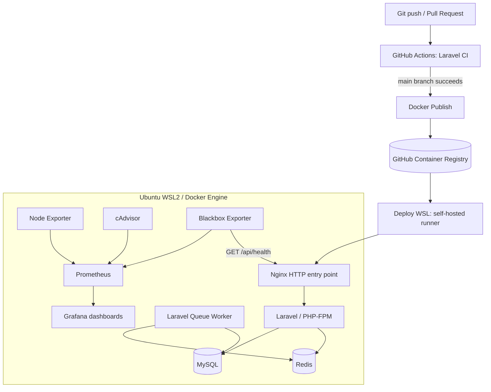

# 📅 Booking API Platform

<div align="center">

**A Laravel booking REST API with containerized infrastructure, automated CI/CD, self-hosted deployment, and observability.**

[](https://www.php.net/)
[](https://laravel.com/)
[](https://www.mysql.com/)
[](https://docs.docker.com/compose/)
[](https://github.com/features/actions)
[](https://grafana.com/)

</div>

---

## 📖 About

Booking API Platform is a **backend and DevOps portfolio project** built around a realistic service-booking workflow. Customers can book available time slots; providers manage services, working hours, and booking statuses. The application enforces authorization rules and prevents conflicting reservations.

Beyond API development, the project demonstrates the delivery lifecycle: **automated checks → container image publishing → deployment → health verification → infrastructure monitoring**.

The deployment runs on **Docker Engine inside Ubuntu WSL2**, using a self-hosted GitHub Actions runner. It is a local learning environment, **not a publicly hosted or highly available production service**.

### ✨ Highlights

- 🔐 **Sanctum authentication** — token-based API access and protected endpoints
- 👥 **Role-based authorization** — admin, provider, and customer roles; Laravel policies
- 📅 **Booking availability** — working hours, breaks, service duration, and existing reservations
- 🔒 **Double-booking protection** — transactions, row locking, and overlap checks
- 🧪 **Automated quality checks** — Laravel tests, Pint, and PHPStan in GitHub Actions
- 🐳 **Containerized stack** — Nginx, PHP-FPM, MySQL, Redis, and a queue worker
- 🚀 **Automated delivery** — GitHub Actions, GHCR, and a self-hosted deployment runner
- ❤️ **Health checks and rollback handling** — post-deployment verification
- 📈 **Observability** — Prometheus, Grafana, Node Exporter, cAdvisor, and Blackbox Exporter

---

## 🛠️ Tech Stack

| Area                | Technologies                                         | Why they are used                                |
| ------------------- | ---------------------------------------------------- | ------------------------------------------------ |
| Backend             | PHP 8.4, Laravel 13                                  | REST API, validation, business logic             |
| Authentication      | Laravel Sanctum                                      | Token-based authentication                       |
| Authorization       | Policies, middleware                                 | Ownership and role-based permissions             |
| Data                | MySQL 8.4, Eloquent ORM                              | Relational data, migrations, transactions        |
| Caching / jobs      | Redis, Laravel Queue Worker                          | Cache and asynchronous job processing            |
| Web server          | Nginx, PHP-FPM                                       | HTTP entry point and PHP execution               |
| Containers          | Docker Engine, Docker Compose                        | Reproducible service environments                |
| CI / quality        | GitHub Actions, PHPUnit/Laravel tests, Pint, PHPStan | Automated verification                           |
| Image registry      | GitHub Container Registry (GHCR)                     | Store built application images                   |
| Deployment          | Self-hosted GitHub Actions runner, Ubuntu WSL2       | Local automated deployment                       |
| Monitoring          | Prometheus, Grafana                                  | Metrics collection and dashboards                |
| Exporters           | Node Exporter, cAdvisor, Blackbox Exporter           | Host, container, and HTTP availability metrics   |
| Development tooling | phpMyAdmin                                           | Database administration in the development setup |

---

## 🏗️ System Architecture



**Request flow:** An HTTP request reaches Nginx, which forwards PHP application requests to Laravel/PHP-FPM. Laravel applies authentication, authorization, validation, and booking rules before interacting with MySQL or Redis.

**Delivery flow:** GitHub Actions validates the code, publishes a container image to GHCR, and invokes a self-hosted runner to deploy it in WSL2. Deployment health checks confirm whether the API responds successfully.

**Monitoring flow:** Exporters expose metrics to Prometheus; Grafana queries Prometheus to visualize host and container performance. Blackbox Exporter actively probes the API health endpoint.

---

## 🎯 Backend Features Explained

### Authentication and roles

- Users can register, log in, and retrieve their authenticated profile.
- Laravel Sanctum protects authenticated API routes.
- Roles: `admin`, `provider`, `customer`.
- Policies and middleware restrict operations to the appropriate role and resource owner.
- Normal registration cannot mass-assign the user role.

### Services and business hours

Providers manage services with a **name, price, duration, and owner**. Prices are stored as integer minor currency units (`€50.00` → `5000`), avoiding floating-point representation for monetary values.

Providers also define weekly working hours and optional breaks. Validation checks time ordering and break boundaries; a database uniqueness constraint prevents multiple business-hour entries for the same provider and weekday.

### Booking lifecycle

Customers create bookings for available slots. Supported statuses are `pending`, `confirmed`, `cancelled`, and `completed`.

```text
pending
├── confirmed
│   ├── completed
│   └── cancelled
└── cancelled
```

Invalid status transitions are rejected. Providers can confirm and complete bookings for their services; customers manage their own bookings.

### Availability and double-booking prevention

Availability depends on the provider's business hours, service duration, breaks, and existing `pending` or `confirmed` bookings.

Booking creation and updates use **database transactions and row locking** alongside overlap checks. An unavailable time slot results in an HTTP `409 Conflict` response.

Example:

```http
GET /api/services/{service}/availability?date=2026-10-05
```

```json
{
  "service": { "id": 28, "name": "Oil Change", "duration": 60 },
  "date": "2026-10-05",
  "available_slots": ["08:00", "10:00", "11:00", "13:00", "14:00", "15:00"]
}
```

---

## 🔌 API Endpoints

The following endpoints describe the main booking functionality. Authentication and role requirements apply as configured in Laravel routes and policies.

| Method   | Endpoint                               | Purpose                                |
| -------- | -------------------------------------- | -------------------------------------- |
| `POST`   | `/api/register`                        | Register                               |
| `POST`   | `/api/login`                           | Login                                  |
| `GET`    | `/api/me`                              | Current user                           |
| `GET`    | `/api/bookings`                        | List accessible bookings               |
| `GET`    | `/api/bookings/{id}`                   | View booking                           |
| `POST`   | `/api/bookings`                        | Create booking                         |
| `PUT`    | `/api/bookings/{id}`                   | Update booking                         |
| `DELETE` | `/api/bookings/{id}`                   | Cancel booking                         |
| `GET`    | `/api/services/{service}/availability` | Available time slots                   |
| `GET`    | `/api/services`                        | List services                          |
| `POST`   | `/api/services`                        | Create service                         |
| `GET`    | `/api/services/{id}`                   | View service                           |
| `PUT`    | `/api/services/{id}`                   | Update service                         |
| `DELETE` | `/api/services/{id}`                   | Delete service                         |
| `GET`    | `/api/business-hours`                  | List business hours                    |
| `POST`   | `/api/business-hours`                  | Add business hours                     |
| `PUT`    | `/api/business-hours/{id}`             | Update business hours                  |
| `DELETE` | `/api/business-hours/{id}`             | Delete business hours                  |
| `PATCH`  | `/api/bookings/{id}/confirm`           | Confirm booking                        |
| `PATCH`  | `/api/bookings/{id}/complete`          | Complete booking                       |
| `GET`    | `/api/health`                          | Deployment and monitoring health check |

The project also includes a simple `/api/hello` test endpoint.

---

## 🗃️ Data Model

```text
User (id, name, email, password, role)
  ├── hasMany Service
  ├── hasMany Booking
  └── hasMany BusinessHour

Service (id, user_id, name, price, duration)
  ├── belongsTo User (provider)
  └── hasMany Booking

BusinessHour (id, user_id, day_of_week, start_time, end_time,
              break_start, break_end)
  └── belongsTo User

Booking (id, user_id, service_id, start_at, status)
  ├── belongsTo User (customer)
  └── belongsTo Service
```

A unique constraint exists on `business_hours(user_id, day_of_week)`. Booking logic also uses transactions and locking to handle concurrent requests.

---

## 🐳 Docker and Infrastructure

The backend runs as multiple services rather than a single process:

| Service        | Responsibility                                  |
| -------------- | ----------------------------------------------- |
| `nginx`        | Receives HTTP traffic and forwards PHP requests |
| `app`          | Runs Laravel with PHP-FPM                       |
| `mysql`        | Persists application data                       |
| `redis`        | Supports cache and queues                       |
| `queue-worker` | Processes background jobs                       |

The WSL deployment uses `backend/compose.wsl.yaml`. Monitoring is defined separately in `monitoring/compose.yaml`, so its lifecycle is independent of the application deployment.

**Docker networking:** Nginx joins both the application network and an external `booking-monitoring` network. Blackbox Exporter uses this shared network to call `http://booking-wsl-nginx-1/api/health`. The external network must exist before deploying on a new host:

```bash
docker network create booking-monitoring
```

Run this command once; if the network already exists, do not recreate it.

---

## 🔄 CI/CD Pipeline

### 1. Laravel CI

On the relevant GitHub events, the CI workflow runs automated tests and code-quality checks, including **Laravel Pint** and **PHPStan**. Failed checks prevent the successful delivery path from proceeding.

### 2. Docker Publish

After successful CI on the deployment branch, GitHub Actions builds the application Docker image and pushes it to **GHCR**, using a commit-derived image tag for traceability.

### 3. Deploy WSL

A **self-hosted GitHub Actions runner** in Ubuntu WSL2 runs the deployment script. The deployment uses the published image, applies migrations, checks API health, and includes rollback handling if deployment verification fails.

```text
Pull Request → CI checks → Merge into main
                             ↓
                        Laravel CI
                             ↓
                       Docker Publish
                             ↓
                            GHCR
                             ↓
                  Deploy WSL (self-hosted)
                             ↓
                  Health check / rollback
```

**Operational limitation:** The self-hosted runner and Docker daemon must be running in WSL2. This lab does not provide cloud hosting, automatic failover, or high availability. Rollback handling should not be interpreted as an automatic reversal of database schema migrations.

---

## 📊 Monitoring and Observability

The `monitoring/` Compose project runs:

- **Prometheus** — scrapes exporter metrics every 15 seconds.
- **Grafana** — visualizes collected metrics.
- **Node Exporter** — exposes Ubuntu CPU and memory metrics.
- **cAdvisor** — exposes Docker container CPU and memory metrics.
- **Blackbox Exporter** — probes the Laravel API over HTTP.

The Grafana dashboard **Booking Platform – Infrastructure** includes Ubuntu CPU, Ubuntu RAM, Docker container CPU, and Docker container RAM panels. A CPU stress test was used to verify that the container CPU chart reflects approximately 100% of one CPU core under load.

### API availability check

The Blackbox job probes:

```text
http://booking-wsl-nginx-1/api/health
```

Prometheus query:

```promql
probe_success{job="booking-api"}
```

- `1` — the HTTP probe succeeded.
- `0` — the probe failed.
- No data — investigate the scrape target and configuration.

The `probe_success` metric checks HTTP availability; it does **not** prove that every booking operation or database transaction is healthy.

### Local dashboards

| Tool               | URL in the WSL lab                 |
| ------------------ | ---------------------------------- |
| Booking API health | `http://localhost:8003/api/health` |
| Prometheus         | `http://localhost:9090`            |
| Grafana            | `http://localhost:3001`            |

Prometheus and Grafana ports are bound to loopback in the provided monitoring Compose configuration. Configure Grafana credentials before sharing the environment.

---

## 🚀 Running and Testing

### Prerequisites

- Docker Engine and Docker Compose v2 (the demonstrated deployment uses Ubuntu WSL2)
- Git, for cloning and working with the repository
- Appropriate environment variables for the selected Compose configuration
- A GitHub self-hosted runner **only if** reproducing the automated WSL deployment

The repository includes different Compose configurations for different environments. **Choose the configuration appropriate to your setup**; do not assume the WSL deployment file can be started without its required environment values and published image.

### Validate configuration

From the repository root, with a properly configured `backend/.env.production`:

```bash
cd backend
docker compose --env-file .env.production -f compose.wsl.yaml config --quiet
```

### Check the running WSL deployment

```bash
curl -fsS http://localhost:8003/api/health
```

Expected response:

```json
{ "status": "ok", "service": "booking-api" }
```

### Start the monitoring stack

From the repository root:

```bash
docker network inspect booking-monitoring >/dev/null || docker network create booking-monitoring
cd monitoring
docker compose up -d
docker compose ps
```

For the API probe to work, the Laravel Nginx container must also be running and attached to the shared `booking-monitoring` network.

### Laravel commands and tests

Run these from `backend/` using the Compose file and environment appropriate to your setup. For a development stack where `app` is running:

```bash
docker compose exec app php artisan test
docker compose exec app php artisan optimize:clear
```

**Do not run `migrate:fresh --seed` against the WSL deployment or any database containing data you want to keep.** That command drops and recreates tables. For normal deployment migrations, use `php artisan migrate --force` through the deployment process.

Tests cover authentication, authorization, services, business hours, booking lifecycle, availability, validation, and double-booking prevention.

---

## 📁 Project Structure

```text
booking-platform/
├── .github/
│   └── workflows/           # CI, image publishing, WSL deployment
├── backend/
│   ├── app/
│   │   ├── Enums/
│   │   ├── Http/
│   │   │   ├── Controllers/Api/
│   │   │   ├── Middleware/
│   │   │   ├── Requests/
│   │   │   └── Resources/
│   │   ├── Models/
│   │   ├── Policies/
│   │   └── Services/
│   ├── database/
│   │   ├── factories/
│   │   ├── migrations/
│   │   └── seeders/
│   ├── routes/api.php
│   ├── tests/Feature/
│   ├── Dockerfile
│   ├── compose.wsl.yaml      # WSL deployment stack
│   └── deploy.sh             # Deployment script
├── monitoring/
│   ├── blackbox/
│   │   └── blackbox.yml
│   ├── prometheus/
│   │   └── prometheus.yml
│   └── compose.yaml
└── README.md
```

---

## 🔒 Security and Operational Notes

- **Authorization:** Laravel policies and middleware enforce ownership and role restrictions.
- **Data integrity:** Database constraints, transactions, and locking help prevent invalid or overlapping bookings.
- **Secrets:** Keep credentials and `.env.production` out of Git; configure secrets securely on the deployment host and in GitHub Actions.
- **Network exposure:** Monitoring dashboards are local to the WSL environment in this project; do not expose them publicly without authentication and network controls.
- **Runner trust:** A self-hosted runner can execute repository workflows on its host. Restrict workflow permissions and deployment triggers appropriately.
- **Availability:** A successful health probe does not replace application-level integration tests, backups, or alerting.

---

## 🎓 What This Project Demonstrates

This project combines **backend engineering** with practical **DevOps fundamentals**:

- Design a role-aware REST API and relational data model.
- Handle booking availability, state transitions, and concurrency.
- Write automated tests and static-analysis checks.
- Run a multi-service application with Docker Compose.
- Build and publish images through GitHub Actions and GHCR.
- Deploy through a self-hosted runner with health verification.
- Observe host performance, container resources, and API availability.

The goal is to understand **how code moves from a commit to a running, observable service**, rather than merely collecting technologies in a stack.

---

<div align="center">

**Built as a backend and DevOps learning project.**

[Repository](https://github.com/JozvanCode/booking-platform)

</div>
